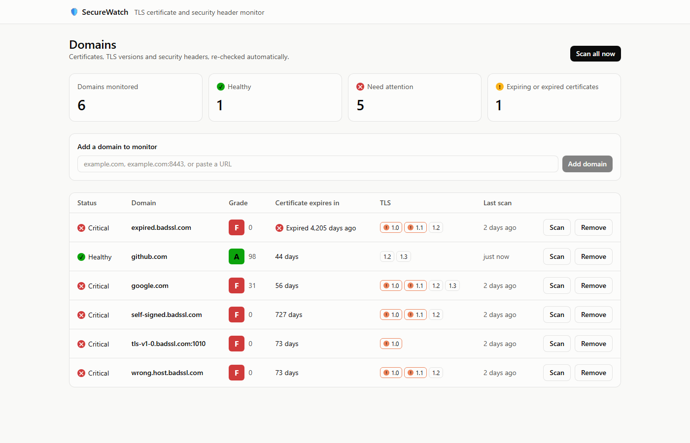
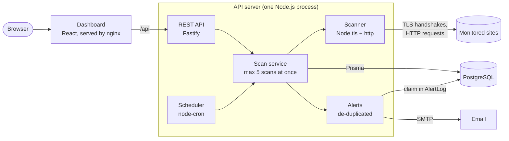
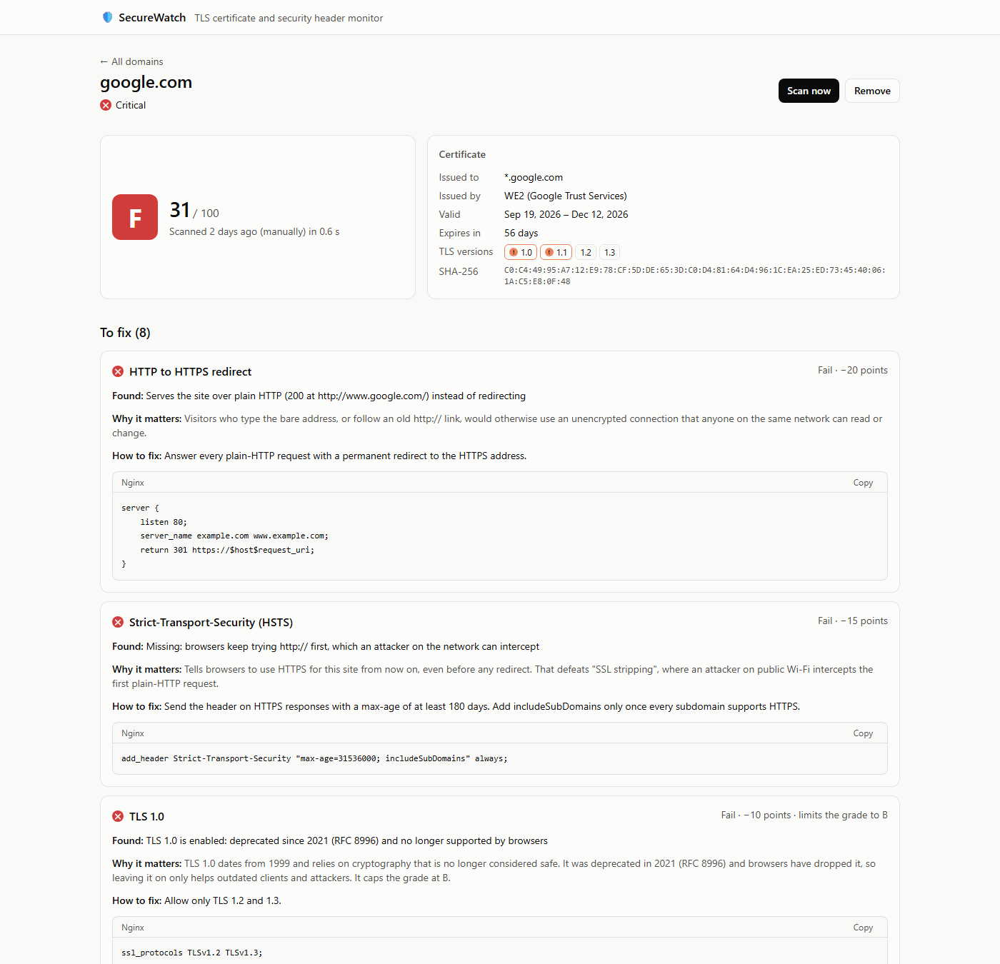
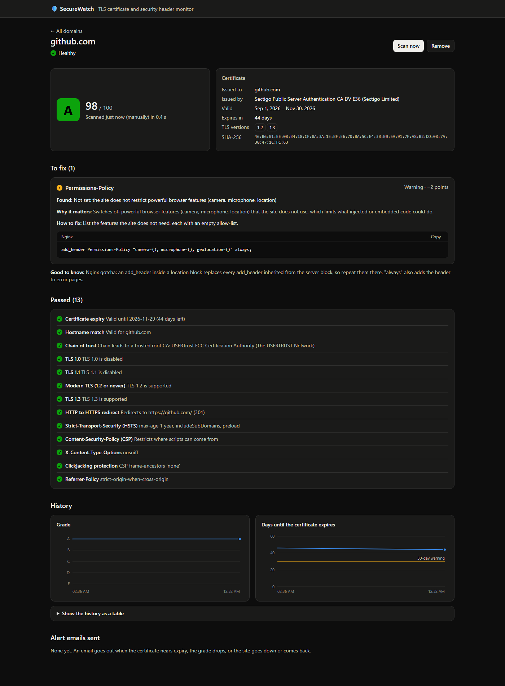

# SecureWatch

**A TLS certificate and security-header monitor.** Add your domains and SecureWatch scans them on a schedule. It grades each one from A to F, explains every problem in plain English with the Nginx config that fixes it, and sums it up in an Insights card that says which fixes to make first. Any page downloads as a Word report you can hand to whoever runs the site. Optionally, with a mail server connected, it also emails you before a certificate expires, when a grade drops, or when a site goes down, and never sends the same alert twice.



## What it checks

| Area | Checks |
|---|---|
| **Certificate** | Days until expiry; whether the hostname matches the certificate (SAN and wildcard rules); whether the chain of trust leads to a trusted root (self-signed, untrusted root, missing intermediate) |
| **Protocols** | Which of TLS 1.0, 1.1, 1.2 and 1.3 the server accepts; 1.0 and 1.1 are flagged as deprecated |
| **HTTPS** | Whether `http://` redirects to `https://` |
| **Headers** | Strict-Transport-Security (max-age, includeSubDomains), Content-Security-Policy, X-Content-Type-Options, X-Frame-Options / CSP frame-ancestors, Referrer-Policy, Permissions-Policy |

Every scan is stored, so each domain has a history: its grade over time and the countdown to certificate expiry.

## Architecture



- **Scanner** ([`server/src/scanner/`](server/src/scanner/)) is built on Node's own `tls`, `http` and `https` modules. It has no database dependency, so it runs from a command line or a unit test as easily as from the server.
- **Scan service** runs scans for the scheduler, the "Scan all" button and "Scan now", at most `SCAN_CONCURRENCY` at a time. It stores each result with all its checks in one transaction.
- **Alerts** compare each new scan with earlier ones and email what changed.
- **Dashboard** ([`web/`](web/)) is React. Every rule (hostname validation, health colours, grade caps, fix advice) comes from the API, so there is one source of truth.

**Stack:** Node.js 24, TypeScript, Fastify 5, PostgreSQL 18, Prisma 7, node-cron, Nodemailer, React 19, Vite, Tailwind CSS, TanStack Query, Vitest, Docker Compose.

## Quick start (Docker)

Needs Docker Desktop, or Docker Engine with Compose.

```bash
docker compose up -d --build
```

Open **http://localhost:8080** and add a domain. To load six demo domains (google.com, github.com and four deliberately broken [badssl.com](https://badssl.com) sites):

```bash
docker compose run --rm migrate npm run db:seed
```

To receive alert emails, put SMTP settings in `server/.env` (see [`server/.env.example`](server/.env.example); Mailtrap's free sandbox works well for testing) and run `docker compose up -d` again.

## Local development

Needs Node.js 24 and Docker (for PostgreSQL).

```bash
docker compose up -d db          # PostgreSQL on 127.0.0.1:5433

cd server
cp .env.example .env
npm install
npm run db:migrate               # create the tables
npm run db:seed                  # optional: the demo domains
npm run dev                      # API on http://127.0.0.1:4000

cd ../web                        # in a second terminal
npm install
npm run dev                      # dashboard on http://localhost:5173
```

In development, alert emails go to a throwaway [Ethereal](https://ethereal.email) inbox, and the server log prints a link to each one.

| Command (in `server/`) | What it does |
|---|---|
| `npm test` | Runs the 77 unit tests (Vitest) |
| `npm run scan -- example.com` | A full graded scan from the command line |
| `npm run check:cert -- example.com` | The certificate check on its own |
| `npm run typecheck` · `npm run build` | Type-check · compile to `dist/` |

## Screenshots

| Each problem explained, with the fix to copy | Dark mode and the scan history |
|---|---|
|  |  |

## Scoring

Every scan starts at 100 points, and each check that does not pass subtracts points. Some problems also **cap** the grade, because nothing else can make up for them: an expired certificate is an F even with perfect headers (SSL Labs grades the same way).

**Score to grade:** A ≥ 90, B ≥ 80, C ≥ 70, D ≥ 60, F below 60. Then the caps apply.

| Check | Warning | Failure |
|---|---|---|
| Certificate expiry | −5: 30 days or fewer left | −100, **grade F**: expired or not yet valid |
| Hostname match | – | −100, **grade F** |
| Chain of trust | −20, **at most B**: missing intermediate | −100, **grade F**: self-signed, untrusted root, … |
| TLS 1.0 enabled | – | −10, **at most B** |
| TLS 1.1 enabled | – | −10, **at most B** |
| Neither TLS 1.2 nor 1.3 | – | −100, **grade F** |
| No TLS 1.3 | −5 | – |
| HTTP → HTTPS redirect | −5: only after other plain-HTTP redirects | −20: serves plain HTTP |
| Strict-Transport-Security | −5: max-age under 180 days, or no includeSubDomains | −15: missing |
| Content-Security-Policy | −5: report-only, `'unsafe-inline'`, or scripts from anywhere | −10: missing |
| X-Content-Type-Options | – | −5 |
| Clickjacking protection | −2: obsolete ALLOW-FROM | −5: missing or invalid |
| Referrer-Policy | −2: missing or leaky | −5: `unsafe-url` |
| Permissions-Policy | −2: missing | – |

A check that cannot be evaluated (for example, the redirect check for a site on a non-standard port) is skipped and costs nothing. The table lives in code in [`server/src/scanner/grade.ts`](server/src/scanner/grade.ts), and a unit test keeps it in sync with the explanations the dashboard shows.

## Alerts

| Alert | Sent when | Sent once per |
|---|---|---|
| Certificate expiring | 30, 14 and 7 days are left, and once it has expired (only the most urgent level that applies) | level **and certificate**, so a renewed certificate starts over |
| Grade dropped | the grade is worse than at the last successful scan | drop |
| Site unreachable | a working site starts failing (after a re-check 3 seconds later) | outage, not per failed scan |
| Site reachable again | a failing site comes back | recovery |

All new alerts for a domain from one scan go out in a single email.

Email is optional. Without a mail server (`SMTP_HOST`), no emails are sent, nothing is recorded as sent, and the dashboard hides the alert history.

## Design decisions

### Why store every scan instead of updating one row per domain
- **History is a feature.** "Grade over time" and the expiry countdown are only possible with past scans.
- **Alerts need the previous state.** "Did the grade drop?" and "was the site already down?" compare a scan with the ones before it.
- **Rows are facts and are never updated.** Values that change with time, such as "days until expiry", are calculated when read, never stored.
- **It is cheap.** Four scans a day of 14 check rows each, served by an index on `(domainId, startedAt DESC)`. A retention job could prune old scans if it ever mattered.

### Why alert de-duplication lives in the database
- **Every alert has a key.** For example, `cert-expiry:14:<certificate fingerprint>`.
- **The key is unique.** The `AlertLog` table has a unique index on `(domainId, dedupeKey)`.
- **Claim, send, release.** To claim alerts, SecureWatch inserts them with `ON CONFLICT DO NOTHING ... RETURNING` and emails only the rows that were really inserted. Postgres does this atomically, so two scans of the same domain, or even two servers, can never both send the same alert. If the email fails, the claim is deleted and the next scan tries again.
- **The trade-off.** A crash between claiming and sending loses that alert ("at most once") instead of risking a duplicate ("at least once"). For a "never spam me" requirement, that is the better side to err on, and the rules already alert on *changes* rather than states.

### Why a concurrency limit
- **Scanning everything at once does not scale.** One scan opens about seven connections: a certificate handshake, four TLS-version probes and two HTTP requests. Fifty domains at once would be hundreds of connections in the same second, which can trip rate limits and firewalls and waste memory.
- **Scanning one domain at a time is too slow.** A single dead site could hold up all the others for its full timeout.
- **A worker pool sits in between.** Five workers each take the next domain as soon as they are free, so a slow site ties up only one of them. Every network operation also has a hard deadline (one per handshake, and one shared by a whole redirect chain).

### Other decisions worth knowing
- **Inspect, don't trust.** The scanner connects with `rejectUnauthorized: false` so it can look at broken certificates, then judges expiry, hostname and trust separately. Only the certificate is read; no data is sent.
- **Probing TLS 1.0 and 1.1** needs OpenSSL 3's security level 0, because those protocols sign the handshake with MD5/SHA-1. It is used only for the version probes.
- **SSRF protection.** Anyone can enter a hostname, so every connection resolves names through a lookup that refuses private, loopback and link-local addresses, such as the cloud metadata service at 169.254.169.254. The check runs inside each connection, so changing a domain's DNS later ("DNS rebinding") cannot get around it. Set `ALLOW_PRIVATE_TARGETS=true` to monitor intranet sites.
- **Practise what we preach.** The dashboard's nginx sends the security headers SecureWatch grades, and the API container runs as a non-root user.
- **One source for every summary.** The dashboard's Insights and the Word reports are both written on the server from the same stored scans and the same scoring table, so the page and the document can never disagree. The reports follow a conventional assessment-report layout: executive summary, scope and method, numbered findings with a severity each, and the grading method as an appendix. Severity is derived from the scoring table (Critical = forces an F, High = 10+ points or a grade cap, Medium = 5–9, Low = under 5) rather than chosen separately. The download is a plain link: the server answers with `Content-Disposition: attachment`, and the browser saves the file itself.

## Configuration

All settings are environment variables. They are validated at startup, and an invalid value stops the server with a clear message.

| Variable | Default | Meaning |
|---|---|---|
| `DATABASE_URL` | – (required) | PostgreSQL connection string |
| `HOST`, `PORT` | `127.0.0.1`, `4000` | Where the API listens (`0.0.0.0` in Docker) |
| `SCAN_CRON` | `0 */6 * * *` | When scheduled scans run (cron syntax) |
| `SCAN_CONCURRENCY` | `5` | Domains scanned at the same time |
| `SCAN_TIMEOUT_MS` | `10000` | Time limit for each network operation |
| `ALLOW_PRIVATE_TARGETS` | `false` | Allow scanning private and internal addresses |
| `SMTP_HOST`, `SMTP_PORT`, `SMTP_SECURE`, `SMTP_USER`, `SMTP_PASS` | –, `587`, `false` | Mail server for alerts. TLS is always required: `SMTP_SECURE=true` for port 465, otherwise STARTTLS |
| `ALERT_EMAIL_TO`, `ALERT_EMAIL_FROM` | –, `SecureWatch <alerts@securewatch.local>` | Alert recipients (comma-separated) and sender |
| `DASHBOARD_URL` | `http://localhost:5173` | Linked from alert emails |
| `LOG_LEVEL` | `info` | `debug`, `info`, `warn`, … |

## API

| Method | Path | Purpose |
|---|---|---|
| `GET` | `/api/domains` | Every domain with its latest scan and health colour |
| `POST` | `/api/domains` | Add a domain: `{ "hostname": "example.com" }` (also accepts `host:port` or a URL) |
| `GET` | `/api/domains/:id` | One domain with its latest scan, every check and its fix |
| `GET` | `/api/domains/:id/scans` | Scan history (`?limit=50`) |
| `GET` | `/api/domains/:id/alerts` | Alert emails sent |
| `POST` | `/api/domains/:id/scan` | Scan now; responds with the stored result |
| `DELETE` | `/api/domains/:id` | Stop monitoring (deletes its history too) |
| `POST` | `/api/scans` | Scan all domains in the background |
| `GET` | `/api/scans/:id` | One stored scan |
| `GET` | `/api/overview` | The plain-English summary across all domains (the dashboard's Insights card) |
| `GET` | `/api/report.docx` | Word report of every domain (`?tz=Asia/Kolkata` sets the time zone for dates) |
| `GET` | `/api/domains/:id/report.docx` | Word report of one domain: every fix, the passed checks and recent scans |
| `GET` | `/api/settings` | Which optional features are on, e.g. `{ "emailAlerts": false }` without a mail server |
| `GET` | `/api/health` | Server and database are up |

## Project structure

```
SecureWatch/
├── .github/workflows/          CI/CD pipeline (GitHub Actions)
├── deploy/                     production add-ons (Caddy, RDS) and the deploy script
├── docker-compose.yml          db, migrate, server, web
├── server/
│   ├── prisma/                 schema.prisma + versioned SQL migrations
│   └── src/
│       ├── scanner/            certificate, TLS versions, redirect, headers, grading
│       ├── alerts/             alert rules, de-duplication, email
│       ├── services/           scanning + saving, the concurrency-limited batch
│       ├── api/                Fastify routes, input validation, response shapes, insights
│       ├── reports/            the Word (.docx) reports
│       ├── scheduler.ts        node-cron job
│       └── index.ts            entry point
├── web/src/
│   ├── pages/                  dashboard, domain detail
│   └── components/             badges, history chart, check list, …
└── docs/screenshots/
```

## Limitations and next steps

- **No login of its own.** Run SecureWatch on a private network or behind a reverse proxy with authentication, such as the Caddy setup in [deploy/](deploy/).
- **One server process.** The scheduler and the "scan in progress" tracking live in memory. Running several servers would need a shared lock (for example, Postgres advisory locks) or a job queue.
- **Some checks are left out.** There are no revocation (OCSP/CRL) checks, no cipher-suite grading, and the CSP check is a heuristic rather than a full policy evaluator.
- **One vantage point.** Scans come from one location; probing from a second one would cut false outage alerts further.

## CI/CD

GitHub Actions ([.github/workflows/ci-cd.yml](.github/workflows/ci-cd.yml)) runs on every pull request and every push to `main`:

| Job | What it proves |
|---|---|
| **Server** | A clean install (`npm ci`), the type-check, the unit tests and the production build all pass |
| **Dashboard** | A clean install, the type-check and the production build pass |
| **Docker stack** | The images build and the whole stack starts from nothing: migrations run on a fresh database, and `/api/health` answers through nginx |
| **Deploy** | Pushes to `main` only, after the three jobs above pass: logs in to the server over SSH and runs [deploy/deploy.sh](deploy/deploy.sh). Skipped until a server is configured: repository variables `DEPLOY_HOST`, `DEPLOY_USER` and `DEPLOY_KNOWN_HOSTS`, and the secret `DEPLOY_SSH_KEY` |

Only GitHub's own actions are used (checkout and setup-node); everything else is plain shell commands, so no third-party code runs in the pipeline.

## Deployment

SecureWatch runs on a single AWS EC2 instance with Docker Compose. [Caddy](deploy/Caddyfile.example) sits in front: it obtains and renews the Let's Encrypt certificate, adds HSTS and asks for a login. The database runs in the same Compose stack, with nightly `pg_dump` backups.

```bash
docker compose -f docker-compose.yml -f deploy/docker-compose.prod.yml up -d --build
```

[deploy/docker-compose.rds.yml](deploy/docker-compose.rds.yml) swaps the local database for Amazon RDS, and [deploy/deploy.sh](deploy/deploy.sh) updates a running server to a commit on `main` (the CI/CD pipeline's Deploy job runs it).
